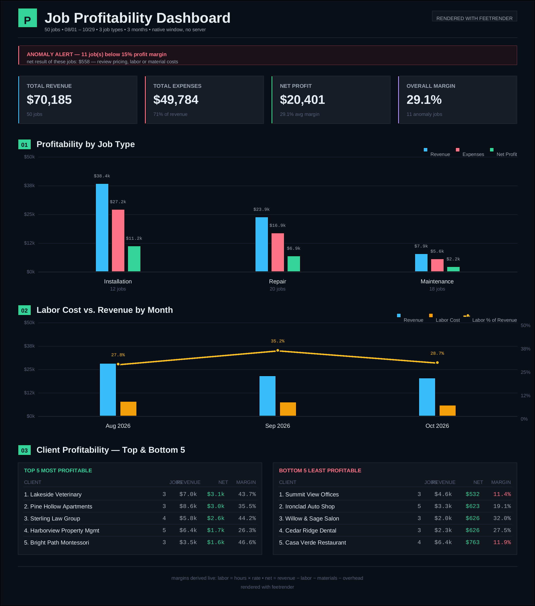

# Job Profitability Dashboard

Local business intelligence dashboard for service jobs — dark mode. Two ways to run it:

- **Native window** — [feetrender](https://github.com/Br1skyy/feetrender) desktop app, no browser, no server: `cd renderer && cargo run --release`
- **Streamlit** — the interactive web app backed by SQLite (`app.py`)



## Files

| File | Purpose |
|---|---|
| `generate_sample_data.py` | Writes `sample_jobs.csv` (50 jobs, Aug–Oct 2026, seeded) |
| `ingest.py` | Loads the CSV into `business_intel.db`; derives `labor_cost`, `net_profit`, `profit_margin` in pure SQL |
| `app.py` | Streamlit dashboard (KPIs with month-over-month deltas, job-type breakdown, monthly labor efficiency, top/bottom clients, live-adjustable margin alert banner) |
| `renderer/` | Rust crate that opens the dashboard in a native window using [feetrender](https://github.com/Br1skyy/feetrender) — `--png` renders a static snapshot instead |

## Native app (feetrender)

Opens the dashboard in a native desktop window — no browser, no localhost:

```bash
cd renderer
cargo run --release                      # native window
cargo run --release -- --png out.png     # static PNG instead
```

Reads `../sample_jobs.csv` by default, or pass a path as the first argument.
Requires Rust ([rustup.rs](https://rustup.rs)). Fonts come from a per-platform
fallback chain (Liberation Sans on Linux, Arial/Helvetica on macOS, Segoe UI on
Windows), so the same code builds everywhere; the layout letterboxes to any
window size, including HiDPI. Verified on Linux; macOS/Windows use the
winit + softbuffer backends those platforms are supported on.

## Run (Streamlit)

Requires Python 3.9+ (package versions are pinned in `requirements.txt`).

```bash
python3 -m venv .venv
.venv/bin/pip install -r requirements.txt
.venv/bin/python generate_sample_data.py   # optional: regenerate the CSV
.venv/bin/python ingest.py                 # (re)build business_intel.db
.venv/bin/streamlit run app.py --server.port 8601
```

Then open http://localhost:8601.

## Notes

- All totals/margins are computed from the database at render time — nothing hardcoded.
- `jobs_raw` keeps the untouched CSV rows; the `jobs` table adds SQL-computed profitability columns.
- Anomaly threshold is `MARGIN_ALERT_PCT` at the top of `app.py` (default 15%).
